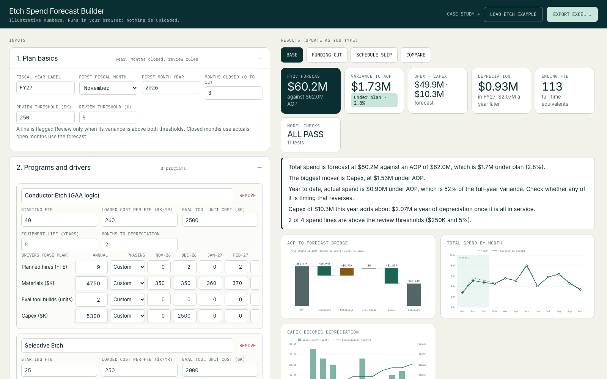

# Etch Spend Forecast Builder

A small web app that turns a handful of inputs into a full Opex and Capex forecast for a set of Etch R&D programs, then exports an Excel workbook with live formulas.

**Try it:** https://kambourr.github.io/etch-spend-forecast-app/
**Case study:** https://kambourr.github.io/Jacob-Kambour-Website/work/etch-portfolio-forecast/



Illustrative numbers only. This is an independent project. It is not Applied Materials data and is not affiliated with or endorsed by Applied Materials.

## What you can do

- Add or remove programs. For each one, enter starting headcount, loaded cost per person, planned hires, materials, eval tool builds and Capex. Type an annual total and pick a phasing (even, front-loaded, back-loaded), or edit any month.
- Set the AOP (annual operating plan) by hand, or fill it from the plan plus a cushion.
- Choose how many fiscal months are closed and enter actuals for them.
- Edit the three scenarios (Base, Funding Cut, Schedule Slip): hiring achieved, materials cut, eval tool cut, Capex cut and slip months.
- Read the result as you type: forecast against AOP, a bridge by line, monthly spend, Capex turning into depreciation, a funding cut by slip sensitivity grid, and 11 model checks.
- Export an Excel workbook (Summary, Inputs, Plan_vs_Actual, Model, Sensitivity, Data) built from your inputs. The Summary, Plan_vs_Actual, Model and Data tabs are live formulas; the Sensitivity tab holds values from the moment of export.

Everything runs in the browser. Nothing is uploaded. Inputs are saved only in your browser's local storage.

## How it is built

| File | Job |
|---|---|
| `engine.js` | The calculation engine. Pure functions, no DOM. |
| `export.js` | Builds the Excel workbook with live formulas (uses ExcelJS). |
| `app.js`, `index.html`, `style.css` | The interface. |
| `example.js` | The Etch example, the same numbers as the case study. |
| `vendor/exceljs.min.js` | ExcelJS 4.4.0 (MIT license, see `vendor/EXCELJS-LICENSE`). |

The model: headcount cost is FTE (full-time equivalents) times loaded cost divided by 12. Materials, eval tools and Capex follow monthly plans scaled by the scenario levers. A slip moves open-month spend later, and closed months never move. Actuals replace the forecast for closed months. Variance is AOP minus forecast, so positive means favorable. Capex depreciates straight-line after a delay.

## How it was checked

```bash
npm install
node tests/test_engine.mjs          # engine against the published workbook: forecast, variance, depreciation, sensitivity
node tests/export_test.mjs tests/out.xlsx        # write a workbook
```

- The engine reproduces the published Etch workbook for all three scenarios (for example Base $60.23M against a $61.97M AOP).
- The exported workbook was recalculated with an independent Python formula engine and compared with the app for 2, 3 and 4 programs and for different scenarios and closed months, with zero formula errors. (`tests/verify_export.py`, needs `pip install formulas openpyxl`.)
- It has not been opened in every spreadsheet program. Excel recalculates on open; some previewers show blanks until they recalculate.

## Limits

- Actuals are entered as numbers for closed months (or filled as plan plus or minus a percent). There is no ledger upload.
- A schedule slip is a pure shift of the plan. A real slip would likely keep some ongoing spend.
- Depreciation is a straight-line illustration with a life and start delay you set. It is a memo and is not in the Opex totals.
- The model leaves out accruals and open purchase orders, allocations, contractors, travel, attrition and merit raises.
- The exported workbook does not include charts.
